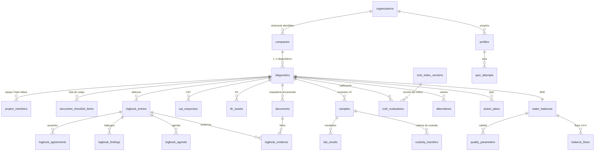

---
# HIDRIA — Plataforma MD-OHI
## 01 · Diseño de Base de Datos y Diccionario de Datos
**Programa «Empresas Hídricamente Responsables» · SRHDS · Gobierno del Estado de Tamaulipas**
Versión 1.0 — Octubre de 2026
Complementa: «Arquitectura HIDRIA-ECT con MD-OHI v2.0»
Archivos técnicos: `02-supabase_schema_hidria_mdohi.sql` (DDL), `03-seed_catalogos.sql` (semillas)
---

# 1. Decisiones de almacenamiento (qué va dónde)

| Tipo de información | Ubicación | Motivo |
|---|---|---|
| Usuarios, empresas, diagnósticos, CAT, IIH, BHE, IVOH, bitácoras, planes, cursos | **Supabase (Postgres)** | Datos transaccionales, relaciones, RLS, cálculos en vivo, tiempo real |
| **Bytes de documentos** (layout, planos, fotos, PDFs de laboratorio, reportes, cuestionarios escaneados) | **Cloudflare R2** | Costo de almacenamiento $0.015/GB-mes y **egress $0**; en Postgres solo viven los metadatos cifrados (tabla `documents`) |
| Secretos (KEK, claves PSC) | Supabase Vault / Worker | Nunca en tablas de negocio |

**Convención de llaves R2:** `org/{organization_id}/diag/{diagnostic_id}/{document_id}.{ext}`. La subida/descarga siempre por URL prefirmada emitida por un Worker (vigencia ≤ 5 minutos) tras validar JWT + membresía; Postgres recibe solo el `r2_key`, hash SHA-256, tamaño y folio.

**Multi-tenancy:** patrón pooled — toda tabla de negocio lleva `organization_id` (tenant = organización del Programa, normalmente la SRHDS). El aislamiento entre **empresas atendidas** no es por tenant sino por **membresía al diagnóstico** (`project_members`): una empresa solo ve las filas de los diagnósticos donde es miembro. Los custom claims del JWT llevan `tenant_id` y `global_role`.

**Catálogos vs. estados:** los estados fijos son `CHECK` constraints; los catálogos extensibles (tipos de activo, flujos del balance, parámetros, preguntas CAT, plantillas de bitácora) son **tablas de catálogo** sembradas (`03-seed_catalogos.sql`) y administrables por el panel.

# 2. Modelo entidad-relación (vista general)

# 3. Esquema base (identidad, tenencia, documentos, auditoría)

## 3.1 `organizations`
Instituciones del ecosistema. Clave de aislamiento RLS.
| Campo | Tipo | Req | Notas |
|---|---|---|---|
| id | uuid PK | S | |
| name | text | S | Razón social o nombre institucional |
| org_type | text CHECK | S | `srhds · universidad · cit · empresa · organismo_operador · prodet · admin` |
| created_at / updated_at | timestamptz | S | |

## 3.2 `profiles` (extiende `auth.users`)
| Campo | Tipo | Req | Notas |
|---|---|---|---|
| user_id | uuid PK → auth.users | S | |
| organization_id | uuid FK | S | Tenant |
| full_name | text | S | |
| position / email / phone | text | N | |
| global_role | text CHECK | S | `admin_institucional · coordinador_srhds · equipo · empresa · observador · invitado` |
| badge_mdohi | bool | S | default false · aprobación del examen del aula (M12) |

## 3.3 `project_members` — membresía por diagnóstico
| Campo | Tipo | Req | Notas |
|---|---|---|---|
| diagnostic_id | uuid FK → diagnostics | S | |
| user_id | uuid FK → profiles | S | |
| organization_id | uuid FK | S | institución a la que representa en el equipo |
| role | text CHECK | S | `coordinador · equipo · empresa · organismo_operador · observador` |
| | PK (diagnostic_id, user_id) | | |

Función auxiliar (security definer): `my_diagnostic_role(uuid) → text`: devuelve el rol del usuario en el diagnóstico o NULL. Es la base de todas las políticas RLS de las tablas del dominio.

## 3.4 `documents` — metadatos (los bytes viven en R2)
| Campo | Tipo | Req | Notas |
|---|---|---|---|
| id | uuid PK | S | = `{document_id}` de la llave R2 |
| organization_id | uuid FK | S | tenant |
| diagnostic_id / company_id | uuid FK | N | ámbito |
| doc_type | text | S | `layout · planos_hidrosanitarios · parametros_calidad · balance_basico · concesion · permiso_descarga · recibos · lab_previo · informe_laboratorio · reporte · plan_accion · otro` |
| title | text | S | |
| r2_key | text UNIQUE | S | `org/…/diag/…/{id}.{ext}` |
| sha256 | text | S | integridad |
| mime / size_bytes | text / bigint | S | |
| exposure_level | text CHECK | S | `publico · anonimizado · sintetico · restringido_nda` (default `restringido_nda` para datos de planta) |
| dek_id | text | N | sobre de cifrado (envelope encryption) |
| folio_nom151 | text | N | constancia de conservación |
| version / parent_document_id | int / uuid | S/N | versionado: Toda modificación = fila nueva |
| uploaded_by | uuid FK → profiles | S | |
| created_at | timestamptz | S | |

Reglas: (1) insert/update solo con URL prefirmada previa (Worker); (2) evidencia que sustenta CAT/IIH/BHE/IVOH/bitácora referencia esta tabla por `document_id`; (3) `exposure_level` define quién descarga y con qué marca de agua.

## 3.5 `signatures` — firma NOM-151 vía PSC
| Campo | Tipo | Req | Notas |
|---|---|---|---|
| id, organization_id | | S | |
| document_id | uuid FK | S | documento a firmar (reporte, plan, NDA, ficha) |
| signer_user_id | uuid FK | N | si es usuario de la plataforma |
| signer_name / signer_role / signer_org | text | S | firmante externo |
| order_no | smallint | S | orden en flujo multi-firmante |
| status | text CHECK | S | `pendiente · firmado · rechazado` |
| psc_provider / folio / constancia_document_id | text | N | proveedor NOM-151 y evidencia |
| signed_at | timestamptz | N | |

## 3.6 `audit_log` — bitácora inmutable encadenada por hash
| Campo | Tipo | Req | Notas |
|---|---|---|---|
| id | bigint PK | S | |
| ts | timestamptz | S | |
| user_id | uuid | N | |
| action | text | S | `create · update · delete · view · download · approve · sign · move_phase` |
| entity / entity_id | text / text | S | tabla y llave afectada |
| meta | jsonb | N | valores clave (antes/después) |
| prev_hash / hash | text | S | cadena: `hash = sha256(prev_hash || fila)` — trigger |

## 3.7 `notifications`
| Campo | Tipo | Notas |
|---|---|---|
| id, user_id, kind | | `hito · validacion · acuerdo · atraso · firma · curso` |
| payload | jsonb | diagnóstico, ficha, acuerdo, folio |
| read_at | timestamptz | null = sin leer |
| created_at | | |

# 4. Dominio MD-OHI

## 4.1 `companies` (M1)
| Campo | Tipo | Req | Notas |
|---|---|---|---|
| id, organization_id | | S | |
| razon_social | text | S | |
| nombre_planta | text | S | |
| giro | text CHECK | S | `manufacturera · maquiladora · termoelectrica · alimentos_bebidas · otra` |
| calle, colonia_parque, cp, municipio | text | S | municipio → organismo operador y estrés hídrico (F2) |
| organismo_operador | text | S | COMAPA, JAD u otro |
| lat / lon | numeric | N | contexto de cuenca |
| empleados / turnos | int / text | N | estimación de usos generales |
| unidad_produccion | text | N | piezas, ton, kWh, litros (CAT A6) |
| contraparte_user_id | uuid FK → profiles | N | responsable designado; validado perfil empresa del tenant (F1-03a) |
| created_by | uuid FK → profiles | N | creador server-side (`auth.uid()`); permite create→read del equipo (F1-03a) |
| ciclo_vida | text CHECK | S | `prospecto · convenio_firmado · activa · diagnostico_vigente · plan_accion · ehr` |
| created_at / updated_at | | S | |

## 4.2 `diagnostics` (M2, objeto rector)
| Campo | Tipo | Req | Notas |
|---|---|---|---|
| id, organization_id | | S | |
| folio | text UNIQUE | S | `MDOHI-{aaaa}-{nnn}` asignado por secuencia |
| company_id | uuid FK | S | |
| tipo | text CHECK | S | `inicial · reevaluacion · seguimiento` |
| fecha_inicio / fecha_fin | date | S | rango de 6 semanas naturales |
| fase_actual | smallint CHECK 1..6 | S | gate validado por trigger `check_phase_gate()` |
| estado | text CHECK | S | `activo · validado · reportado · archivado · suspendido · reprogramado` |
| ivoh_actual | numeric(3,1) | N | de la vista `v_ivoh_score` |
| brecha_pct | numeric(5,2) | N | de la vista `v_bhe_summary` |
| avance_pct | numeric(5,1) | S | default 0 — alimenta tarjeta Kanban |
| proximo_hito | text | N | `R1..R5 · V1..V3` + fecha (vista) |
| semaforo_atraso | text CHECK | S | `verde · amarillo · rojo` (calculado por job diario) |
| cat_estado | text CHECK | S | `no_enviado · en_captura · en_revision · validado_r2` |
| index_version_id | uuid FK → ivoh_index_versions | S | versión vigente del IVOH |
| bitacora_cerrada | bool | S | default false — prerrequisito del reporte |
| reporte_document_id | uuid FK → documents | N | versión emitida |
| reprogramacion_justificacion | text | N | extensión documentada (regla del manual) |
| created_at / updated_at | | S | |

## 4.2.1 `milestone_reprogramming` (M2/M11, F1-04)
| Campo | Tipo | Req | Notas |
|---|---|---|---|
| id | bigint identity | S | |
| diagnostic_id | uuid FK → diagnostics | S | |
| organization_id | uuid FK → organizations | S | |
| hito | text CHECK | S | `V1..V3`, `R1..R5` |
| fecha_original / fecha_nueva | date | S | `fecha_nueva ≥ fecha_original` |
| causa | text CHECK | S | `empresa · equipo · externa` |
| justificacion | text | S | ≥ 20 caracteres |
| reprogramado_por | uuid FK → profiles | S | coordinador |
| created_at | timestamptz | S | |

RLS: **SELECT** por `is_diagnostic_member(diagnostic_id)`; **sin DML** para `authenticated`; escritura solo por la RPC `fn_reprogram_milestone` (`service_role`, ADR-013).

> **Nota F1-04:** `fn_advance_phase` (EF-01) y `fn_reprogram_milestone` (EF-12) son RPC `SECURITY DEFINER` ejecutables **solo por `service_role`**; actualizan `diagnostics`, auditoría, historial e idempotencia en una sola transacción. `check_phase_gate` y `trg_diagnostics_update_lock` siguen siendo la autoridad final; el cliente no ejecuta estas RPC. `p_gate` es cálculo de la EF para auditoría/respuesta, no una autorización. F1 entrega fases 1–3 reales; F4–F6 con fixtures hasta F2-06 (M5/IIH).

## 4.3 `document_checklist_items` (M3)
| Campo | Tipo | Notas |
|---|---|---|
| id, diagnostic_id | | |
| item_code | text | catálogo: `layout · planos · parametros_calidad · iih · balance_basico · concesion · permiso_descarga · recibos · lab_previos · otra` |
| estado | CHECK | `no_recibido · recibido · revisado · validado_r1` |
| document_id | uuid FK → documents | |
| solicitud_nota | text | lo pedido «en la misma reunión R1» |

## 4.4 CAT (M4)
`cat_items` — plantilla versionada del Anexo A:
| Campo | Tipo | Notas |
|---|---|---|
| id, version (text), seccion (char), codigo (text UNIQUE por versión: A1…) | | |
| enunciado / tipo | | `abierta · breve · opcion_unica · multiple` |
| opciones | jsonb | claves de opción |
| ayuda | text | texto del instructivo (para qué se usa el dato) |
| admite_evidencia | bool | |
| condicion | jsonb | p. ej. `{"depends_on":"B1","contains":"pozo"}` |
| orden | smallint | |

`cat_responses`:
| Campo | Tipo | Notas |
|---|---|---|
| diagnostic_id, item_id | | PK (diagnostic_id, item_id) |
| valor | jsonb | texto o clave(s) |
| no_se / na | bool | «No sé» trazable → tarea de campo |
| document_id | uuid FK | evidencia adjunta |
| resuelta_en_campo | bool | |
| created_by / updated_at | | guardado parcial ilimitado |

## 4.5 IIH (M5)
Catálogos: `iih_stages` (6 etapas: CAP, ALM, TRA, DIS, USO, EVA) e `iih_asset_types` (~70 tipos precargados, agrupados por etapa, con código y nombre).
`iih_assets` (una fila por activo, equivalencia columna a columna con la plantilla):
| Campo | Tipo | Notas |
|---|---|---|
| id, diagnostic_id, organization_id | | |
| folio | text UNIQUE | `CAP-01…EVA-nn` asignado por trigger (no reutilizable) |
| stage_code | FK → iih_stages | prefijo del folio |
| asset_type_id | FK → iih_asset_types | |
| tag / ubicacion | text | TAG interno; ubicación con referencia a layout/plano |
| capacidad / capacidad_unidad | numeric / text | volumen útil, caudal, vapor… |
| potencia_kw | numeric | |
| material / anio_instalacion | text / int | antigüedad calculada |
| estado_fisico | CHECK | `bueno · regular · deficiente · fuera_de_servicio` |
| opera | CHECK | `si · no · parcial` |
| criticidad | CHECK | `alta · media · baja` (qué pasa si falla) |
| respaldo | bool | redundancia |
| suficiencia | CHECK | `suficiente · limitada · insuficiente` |
| mantenimiento_tipo | CHECK | `preventivo · correctivo · mixto · nulo` |
| ultimo_servicio | date | |
| intervencion | CHECK | `ninguna · rehabilitacion · reposicion · ampliacion` |
| prioridad | text | calculada en trigger: f(estado, criticidad, opera) → `alta · media · baja` |
| observaciones | text | trazabilidad de la fuente del dato |
| verificado_v1 | bool | cierre de verificación en campo |
| created_at / updated_at | | |

Mínimo obligatorio (validado en app): tag, ubicación, estado, opera, criticidad, intervención — sin ellos el activo se guarda como «incompleto».

## 4.6 BHE (M6)
`balance_flow_catalog`: `grupo` (`entrada · consumo_proceso · consumo_general · descarga · perdida · circular`), `code`, `nombre`, `orden`, `activo`.
Catálogo sembrado: 5 entradas, 15 destinos, 4 flujos circulares (ajustable a la estructura exacta de la plantilla Excel).

`water_balances` (una versión por diagnóstico; reevaluaciones crean nueva fila):
| Campo | Tipo | Notas |
|---|---|---|
| id, diagnostic_id, organization_id | | |
| periodo_anio / mes_inicio | smallint | 12 meses consecutivos, declarados |
| fuente_origen | CHECK | `nativa · importada_excel` |
| estado | CHECK | `borrador · en_captura · validado_r3` |
| validado_r3_logbook_id | uuid | ficha R3 que lo validó |
| produccion_mensual | numeric[12] | alineada al periodo del agua (regla del instructivo) |
| unidad_produccion | text | |
| dias_operacion | int | del CAT A5 (carga contaminante) |
| dq0_mg_l / dbo5_mg_l | numeric | para carga contaminante |
| version / created_at / updated_at | | |

`balance_flows`: PK (balance_id, catalog_code, mes); `volumen_m3 numeric(12,2) CHECK >= 0`, `fuente_dato`, `comentario`, `metodo_estimacion` (macromedidor, ultrasónico, aforo, estimación documentada).

`quality_parameters_catalog`: `code`, `nombre`, `grupo` (`basico · patogeno · metal · toxicidad · reuso_proceso`), `unidad_default`.
`quality_parameters`: PK (balance_id, code); `valor`, `unidad`, `limite_aplicable`, `norma_ref` CHECK (`NOM-001 · NOM-002 · NOM-003 · condiciones_particulares · proceso`), `dictamen` bool, `lab_result_id`.

Vistas calculadas (la «hoja 4 como tablero»):
- `v_bhe_monthly`: entradas, destinos, circular y **brecha (m³ y %)** por mes.
- `v_bhe_summary`: brecha global con semáforo (>10 % = hallazgo).
- `v_balance_indicators`: consumo anual, **consumo específico** (m³/unidad), **% reúso/recirculación**, **% agua no contabilizada**, **carga contaminante** diaria (DQO/DBO₅ × caudal).

## 4.7 Muestreo y laboratorio (M7)
`samples`: `codigo` UNIQUE (`{folio-diag}-Mnn`), `punto` CHECK (`descarga_final · corriente_interna`), `tipo_muestra` CHECK (`simple · compuesta`), `n_simples`, `colecta_ts`, `caudal_momentaneo`, `preservacion`, `params_solicitados` jsonb (catálogo de parámetros), `norma_ref`, `laboratorio`, `acreditacion_ema` bool, `estado` CHECK (`planificada · colectada · enviada · en_analisis · resultados_recibidos · descartada`).
`custody_transfers`: PK (sample_id, secuencia); `etapa` CHECK (`muestreo · entrega · recepcion`), persona/rol/org, `ts`, `firma`, `temperatura_recepcion`, `integridad_recipiente`, observaciones. **Regla:** sin las 3 transferencias firmadas, `lab_results.dictamen` queda bloqueado (trigger).
`lab_results`: PK (sample_id, param_code); `valor`, `unidad`, `metodo`, `informe_document_id`, `dictamen` bool.

## 4.8 IVOH (M8)
`ivoh_index_versions`: `version` int, `vigente` bool (una vigente; inmutable una vez aprobada), `aprobado_por`, `fecha_aprobacion`.
`ivoh_factors`: PK (version_id, factor_code F1..F6); `nombre`, `peso` numeric(3,2) (0.15/0.20/0.20/0.20/0.15/0.10 en v1).
`ivoh_rubrics`: PK (factor_code, nivel_min): `nivel_max`, `etiqueta` (Incipiente/Básico/Consolidado/Referente), `descripcion`.
`ivoh_evaluations`: PK (diagnostic_id, factor_code); `version_id`, `puntaje` numeric(2,1) CHECK 0–10, `justificacion`, `evidencia` jsonb (vínculos a documentos, activos, indicadores, fichas), `estado` CHECK (`borrador · validado_r4`), `r4_logbook_id`.
Vista `v_ivoh_score`: IVOH = Σ peso×puntaje (1 decimal), semáforo (`<5 rojo · 5–7.9 amarillo · ≥8 verde`) y serie para la gráfica radial. **Gate:** evaluación solo insertable si existe `water_balances.estado='validado_r3'` del diagnóstico (trigger).

## 4.9 Cartera y Plan de Acción (M9)
`alternatives`: `jerarquia` smallint CHECK 1–5 (Reducir…Repensar), `descripcion`, `factores_mejora` jsonb, `ahorro_m3_anio`, `ahorro_financiero`, `capex`, `opex`, `retorno_simple`, `prioridad` CHECK (`alta · media · baja`), `verificado_v3` bool, `validado_r4` bool.
`action_plans` + `action_plan_items`: objetivo; acción, responsable, `fecha_inicio/fin` (vista Gantt), `indicador_verificacion`, `estado`; `firmado` bool + `signature_flow_id`.
`completeness_items` (config, 10 renglones sembrados) y vista `v_diagnostic_completeness`: un booleano por prerrequisito; `reporte_emitible = AND de todos` — el gate del generador del reporte (M9).

## 4.10 Bitácora (M10)
`logbook_templates`: clave (V1..R5), semana, tipo, titulo, duración, `objetivo`, `asistentes_requeridos`, `agenda_items` jsonb, `evidence_items` jsonb — la semilla trae las 8 fichas con sus agendas y checklists oficiales.
`logbook_entries`:
| Campo | Tipo | Notas |
|---|---|---|
| id, diagnostic_id, organization_id | | |
| clave | CHECK (V1,V2,V3,R1..R5) | |
| folio | UNIQUE, auto `BIT-{clave}-{nn}` | trigger |
| responsable_sesión | text | |
| fecha / horario_inicio / horario_fin | | cierre ≤ fecha+24 h (validado en app y job) |
| modalidad | CHECK `presencial · virtual · mixta` | |
| lugar | text | |
| estado | CHECK `abierta · cerrada` | cerrada = inmutable |
| cerrada_en / cerrada_razon | timestamptz / text | si >24 h exige razón |
| version | int | default 1 |
Hijas 1:1 o 1:N: `logbook_participants` (nombre, cargo, institución, contacto, firma_ts), `logbook_agenda` (no, actividad — precargada del template —, responsable, resultado, estado `realizado/modificado/no_realizado`), `logbook_findings` (texto, tema, links jsonb a activos/CAT/flujos/factores), `logbook_agreements` (compromiso, responsable, fecha, seguimiento, cerrado), `logbook_evidence` (item del template, document_id/folio obligatorio), `logbook_change_log` (versión, descripción, responsable, prev jsonb).
`photo_log`: folio auto `{clave}-{nn}` (+ `· USO-01` cuando documenta un activo), document_id, geo, descripción.
`diagnostics.bitacora_cerrada` + firmas de cierre (semana 6): elabora + valida SRHDS.

## 4.11 Aula (M12)
`course_modules` (orden, título, materiales jsonb), `quiz_questions` (module, pregunta, opciones jsonb, correcta int, retroalimentación), `quiz_attempts` (user_id, score, passed, ts, answers jsonb).

# 5. Matriz RLS (resumen de políticas en el DDL)

| Tabla | SELECT | INSERT/UPDATE/DELETE |
|---|---|---|
| organizations, profiles | miembros del mismo tenant; **invitado solo su propio perfil** | admin del tenant |
| companies, diagnostics | `my_diagnostic_role(diag)` not null, o agregado SRHDS (admin/coord); **invitado sin membresía: 0** | coordinador/equipo/empresa según módulo |
| cat_responses, document_checklist_items | miembros del diagnóstico | `empresa` y `equipo`/`coordinador` (empresa solo sus aportaciones) |
| iih_assets, balance_flows, logbook_* | miembros del diagnóstico | `equipo`/`coordinador` (empresa solo valida en R3/R4/R5 por flujo de firma) |
| samples, custody_transfers, lab_results, ivoh_evaluations, alternatives | miembros del diagnóstico | `equipo`/`coordinador` |
| ivoh_index_versions, catálogos, templates | autenticados | admin institucional |
| quiz_attempts | propio usuario + SRHDS (agregado) | propio usuario |
| audit_log | append-only vía trigger; SELECT admin/SRHDS | sin UPDATE/DELETE (revocado) |
| documents (metadatos) | según exposure_level y membresía; **invitado solo con membresía** | miembros del diagnóstico; bytes solo vía R2 prefirmado |

> **Nota F1-18 / task-59+66 (restricción por columna en `diagnostics`):** el INSERT se
> limita a `coordinador_srhds`/`equipo` (empresa retirada hasta M2 por ownership); el
> `folio` es inmutable en UPDATE y los campos de gate/estado (`estado`,
> `reporte_document_id`, `bitacora_cerrada`, `avance_pct`, `cat_estado`, semáforo,
> IVOH/brecha, próximo hito, reprogramación) solo los actualiza `service_role`/EF
> (`diagnostics_update_lock`, ADR-010). Un RPC `security definer` autenticado no basta:
> `auth.uid()` sigue no nulo y el trigger lo bloquea.
>
> **Nota task-35 (Q-02/SEC-PR7-D2, M2):** en `documents`, `iih_assets`, `samples`,
> `signatures` y `water_balances` **todos los roles** (incluidos admin/coord) requieren
> `is_diagnostic_member(diagnostic_id)`; **no hay agregado SRHDS** en esas 5. `diagnostics` y
> `companies` conservan membresía o agregado admin/coord. `profiles` muestra al invitado solo
> su fila; sin claim `global_role` no hay filas. `organizations` es el tenant propio y
> `project_members` la membresía del diagnóstico. Un invitado tiene **una** membresía activa;
> la vigencia temporal queda para F1-04 (ADR-011).
>
> **Nota F1-03a (M1 Empresas):** `companies` añade `created_by` server-side; `companies_sel`
> incluye al creador (create→read), a la empresa con `contraparte_user_id = auth.uid()` y el
> agregado admin/coord/membresía. Solo admin/coord asigna `contraparte_user_id` (perfil
> `empresa` del mismo tenant); `created_by` es inmutable. `ciclo_vida` sigue editable por los
> roles de escritura, sin candado adicional (decisión F1-03a).

# 6. Reglas implementadas como triggers (en el DDL)

1. **Folios correlativos no reutilizables**: IIH (`CAP-01…`), bitácora (`BIT-V1-01`), fotos (`V1-01`).
2. **Cadena de custodia**: `lab_results.dictamen` requiere 3 transferencias firmadas de la muestra.
3. **Gate IVOH**: sin BHE `validado_r3` no hay evaluación.
4. **Gate de fase**: `check_phase_gate()` valida los entregables de la fase origen antes de permitir `fase_actual+1` (lista de cotejo validada R1 → CAT validado R2 → V1+IIH → custodia V2 → BHE R3 → IVOH R4 → completitud+cierre).
5. **Inmutabilidad**: `logbook_entries` cerradas rechazan UPDATE (salvo vía `logbook_change_log` que crea nueva versión); `ivoh_index_versions` vigentes rechazan UPDATE.
6. **Auditoría encadenada**: hash en `audit_log` por trigger, append-only.
7. **Actualización de `updated_at`** en todas las tablas.
